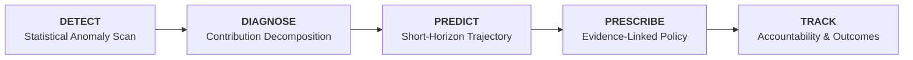

# CreditPulse AI

[](https://creditpulse-aimon.streamlit.app)
[](https://www.python.org/downloads/)
[](https://opensource.org/licenses/MIT)
[](#testing)

**An intelligent credit portfolio monitoring and decision-support platform for banks, NBFCs, and retail lending institutions.**

CreditPulse AI transforms granular loan-level data into evidence-backed risk intelligence. It couples standard banking credit analytics (PAR, DPD buckets, vintage deterioration curves, roll-rate transition dynamics) with an AI-driven decision-support layer following a disciplined intelligence workflow:

$$\mathbf{DETECT} \longrightarrow \mathbf{DIAGNOSE} \longrightarrow \mathbf{PREDICT} \longrightarrow \mathbf{PRESCRIBE} \longrightarrow \mathbf{TRACK}$$

> 🌐 **Live Demo:** [https://creditpulse-aimon.streamlit.app](https://creditpulse-aimon.streamlit.app)

---

## 🏛️ Executive Product Architecture

```
creditpulse-ai/
├── app.py                      # Router & navigation shell (Streamlit multi-page)
├── config/
│   ├── settings.py             # Single source of truth (seed, buckets, paths, theme)
│   └── simulation.py           # Simulation profiles (products, branches, risk multipliers)
├── src/
│   ├── data/                   # Synthetic portfolio generator, schema, validation, I/O
│   ├── metrics/                # Pure-Python engines: portfolio, delinquency, vintage, roll rates
│   ├── intelligence/           # Anomaly detection, root cause diagnosis, forecasting, prescriptions
│   ├── analyst/                # Evidence-grounded conversational AI Credit Analyst
│   ├── actions/                # Action tracking & operational lifecycle service (SQLite)
│   └── utils/                  # Indian currency (₹ L/Cr) formatting & application logging
├── components/                 # Theme definitions & layout UI building blocks
├── pages/                      # 7 Interactive Enterprise Dashboards
├── database/                   # SQLite engine, sessions, and SQLAlchemy models
├── tests/                      # Pytest suite (101 automated unit & integration tests)
└── docs/                       # Architecture, data dictionary, methodology, roadmap
```

---

## 📊 Core Product Modules

| Module | Key Capabilities | Business Impact |
| :--- | :--- | :--- |
| **1. Executive Portfolio Overview** | Total disbursement, outstanding POS, active accounts, average ticket size, PAR30/60/90, collection efficiency, trends, and product/branch distribution. | High-level portfolio liquidity, volume growth, and asset quality tracking for C-level leadership. |
| **2. Delinquency Analytics** | DPD bucket distribution (`0 DPD` to `90+ DPD`), historical 36-month PAR evolution, First Payment Default (FPD 30) early warning indicator, and branch delinquency matrices. | Early identification of payment slippages before accounts migrate to non-performing status. |
| **3. Vintage Analysis** | Month-on-Book (MOB 1 to 36) default matrices, vintage delinquency curves, and cohort degradation comparison across origination quarters. | Isolates underwriting quality shifts across lending cycles from seasoning effects. |
| **4. Roll Rate Analysis** | Bucket-to-bucket transition matrices ($t \rightarrow t+1$), roll forward rates, cure rates, and flow rate tracking between consecutive cycles. | Predicts provision requirements and measures collection operational efficiency. |
| **5. Intelligence Centre** | Automated statistical anomaly detection (Z-scores, threshold outliers), root cause additive contribution analysis, and fact-vs-hypothesis separation. | Closes the loop from raw metric monitoring to automated diagnostic discovery. |
| **6. AI Credit Analyst** | Conversational Q&A copilot answering natural-language portfolio inquiries with strict citations to verified empirical facts and zero data fabrication. | Enables risk heads and portfolio managers to query complex metrics instantaneously. |
| **7. Action Tracker** | Operational accountability engine tracking recommended policy changes, assigning owners, due dates, statuses (`Planned` $\rightarrow$ `Completed`), and measured outcomes. | Ensures intelligence translates into audited business execution. |

---

## 🔬 Evidence-First Intelligence Sequence

CreditPulse AI adheres to strict analytical standards to ensure reliability in regulated financial environments:



1. **DETECT:** Flags statistically significant deviations across products, branches, cohorts, and time-series metrics.
2. **DIAGNOSE:** Quantifies the exact mathematical contribution share of borrower segments to an observed change, separating verifiable facts from speculative hypotheses.
3. **PREDICT:** Projects near-term risk trajectories across 3-month horizons with explicit 90% confidence volatility bands.
4. **PRESCRIBE:** Generates policy actions (Underwriting, Collections, Exposure Limits) tied directly to finding citations.
5. **TRACK:** Logs actions in SQLite with assigned owners and monitors measurable risk reduction outcomes.

---

## 🛠️ Technology Stack

- **Core Application:** Python 3.11 / 3.12, Streamlit 1.40+
- **Data Engineering & Analytics:** Pandas 2.2+, NumPy 1.26+, Scikit-learn 1.5+
- **Interactive Visualizations:** Plotly 5.24+
- **Persistence Layer:** SQLite, SQLAlchemy 2.0+
- **Automated Testing:** Pytest 8.3+ (101 automated test cases)
- **Deployment:** Streamlit Community Cloud, GitHub

---

## 🚀 Local Installation & Setup

```bash
# 1. Clone repository
git clone https://github.com/srimonika20-source/CreditPulseAI.git
cd CreditPulseAI

# 2. Create and activate virtual environment
python -m venv .venv
# On Windows:
.venv\Scripts\activate
# On Linux/macOS:
source .venv/bin/activate

# 3. Install dependencies
pip install -r requirements.txt

# 4. Generate synthetic portfolio (20,000 loans, 36 months)
python -m src.data.pipeline

# 5. Run automated test suite
pytest

# 6. Launch the dashboard
streamlit run app.py
```
Open **`http://localhost:8501`** in your browser.

---

## 🔒 Data Privacy & Compliance Notice
This project uses **100% synthetic data** simulating an Indian Non-Banking Financial Company (NBFC). Customer identifiers, names, and branches are completely fictional. No real borrower information, PII, or confidential banking records are utilized.

---

## 📄 License
This project is licensed under the [MIT License](LICENSE).
