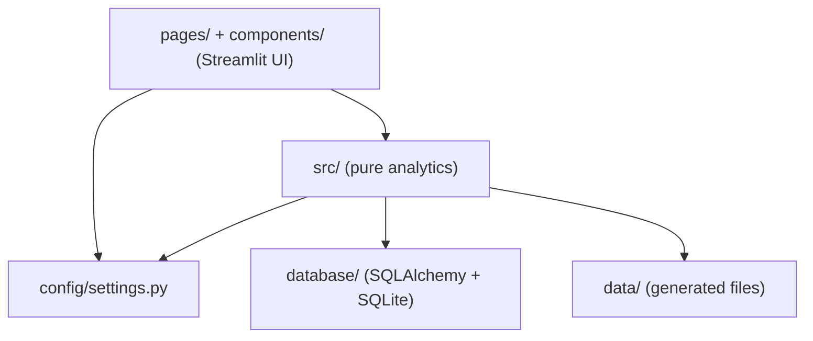

# Architecture

## Layers

* **UI layer** (`app.py`, `pages/`, `components/`) handles presentation only.
* **Analytics layer** (`src/`) never imports Streamlit, so it can be unit-tested and reused.
* **Configuration** (`config/settings.py`) is the single source of truth for paths, simulation parameters, risk definitions, theme colours, and the module and phase registries.
* **Persistence** (`database/`) provides the SQLAlchemy engine, sessions and ORM models.

## Navigation

`app.py` builds grouped sidebar navigation (`st.navigation`) from `config.settings.MODULES`. To add a module, add a `ModuleInfo` entry and a page file. The landing page, sidebar and tests pick it up automatically.

## Intelligence pipeline

| Stage | Module | Output |
|---|---|---|
| Detect | `src/intelligence/anomaly_detection.py` | `Finding` objects (metric, segment, observed vs expected, significance) |
| Diagnose | `src/intelligence/root_cause.py` | Additive contribution tables (observed). Hypotheses are labelled separately. |
| Predict | `src/intelligence/forecasting.py` | Projections with uncertainty ranges |
| Prescribe | `src/intelligence/recommendations.py` | `Recommendation` objects that reference finding IDs |
| Track | `src/actions/tracker.py` | Persisted actions with owner, due date, status, outcome |

## Design system

| Token | Value | Usage |
|---|---|---|
| Navy | `#0B2545` | Headings, titles |
| Teal | `#0E9F9A` | Accent, primary actions, active states |
| White | `#FFFFFF` | Page background, cards |
| Light grey | `#F5F7FA` | Sidebar, secondary panels |
| Border | `#E3E8EF` | Card and table borders |
